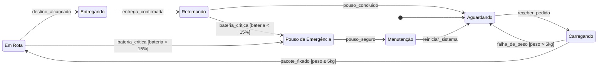

# 🚁 AeroDrop – Diagrama de Máquina de Estados UML

Modelagem do ciclo de vida de um drone autônomo de entregas da startup fictícia **AeroDrop**, usando o **Diagrama de Máquina de Estados da UML**. O trabalho parte de um relato do Engenheiro Chefe e identifica estados, eventos, transições e condições de guarda, incluindo o desvio de segurança por bateria baixa.

**Aluno:** Giulio Pimentel de Freitas · **Turma:** 2 DS

---

## 📄 Relatório completo

O relatório em PDF, com o diagrama desenhado, a tabela de transições e as decisões de modelagem, está em:

[`AeroDrop_Diagrama_Maquina_de_Estados.pdf`](./AeroDrop_Diagrama_Maquina_de_Estados.pdf)

---

## 🧭 Diagrama

O GitHub renderiza o diagrama abaixo automaticamente (Mermaid).

---

## 🧩 Estados

| Estado | Descrição |
|---|---|
| **Aguardando** | Drone ligado, na base, disponível para uma missão. É o estado alcançado pelo pseudoestado inicial. |
| **Carregando** | A esteira coloca a caixa no drone e o peso é validado (capacidade máxima de 5 kg). |
| **Em Rota** | Drone decolou e voa até o cliente. |
| **Entregando** | Drone desceu no destino e solta o pacote. |
| **Retornando** | Entrega concluída; drone volta à base. |
| **Pouso de Emergência** | Missão abortada por bateria crítica; pouso seguro no solo. |
| **Manutenção** | Drone no solo emitindo sinal de resgate, aguardando um técnico. |

## ⚡ Eventos

| Evento | Significado |
|---|---|
| `receber_pedido` | O sistema central envia um pedido e inicia a missão. |
| `falha_de_peso` | O peso da caixa excede a capacidade e a missão é cancelada. |
| `pacote_fixado` | O peso foi validado e a caixa está fixada, o que autoriza a decolagem. |
| `destino_alcancado` | O GPS confirma a chegada ao cliente. |
| `entrega_confirmada` | A câmera confirma que o pacote foi solto. |
| `pouso_concluido` | O drone pousou na base ao final do retorno. |
| `bateria_critica` * | O sistema detecta bateria abaixo de 15% e aborta a missão. |
| `pouso_seguro` * | O pouso de emergência foi concluído com segurança. |
| `reiniciar_sistema` | O técnico aciona o botão físico de reinício. |

\* Nomes atribuídos pelo analista: o relato descreve esses acontecimentos, mas não os nomeia.

## 🔀 Tabela de transições

| # | Origem | Evento `[guarda]` | Destino |
|---|---|---|---|
| T0 | Pseudoestado inicial | ao ligar o drone | Aguardando |
| T1 | Aguardando | `receber_pedido` | Carregando |
| T2 | Carregando | `falha_de_peso` **[peso > 5kg]** | Aguardando |
| T3 | Carregando | `pacote_fixado` **[peso ≤ 5kg]** | Em Rota |
| T4 | Em Rota | `destino_alcancado` | Entregando |
| T5 | Entregando | `entrega_confirmada` | Retornando |
| T6 | Retornando | `pouso_concluido` | Aguardando |
| T7 | Em Rota | `bateria_critica` **[bateria < 15%]** | Pouso de Emergência |
| T8 | Retornando | `bateria_critica` **[bateria < 15%]** | Pouso de Emergência |
| T9 | Pouso de Emergência | `pouso_seguro` | Manutenção |
| T10 | Manutenção | `reiniciar_sistema` | Aguardando |

---

## 📝 Decisões de modelagem

- **Guardas do carregamento:** `[peso ≤ 5kg]` e `[peso > 5kg]` são mutuamente exclusivas e cobrem todos os casos, então Carregando sempre segue por exatamente uma transição.
- **Exceção da bateria:** só sai de **Em Rota** e **Retornando**, os estados em voo citados no relato, e vai para **Pouso de Emergência**.
- **Saída da Manutenção:** só ocorre por `reiniciar_sistema`, uma ação humana. O drone não volta a operar sozinho depois de uma falha de bateria.
- **Sem estado final:** o relato descreve um ciclo contínuo de missões e não menciona desligamento.

## 🛠️ Ferramentas

Diagrama UML de Máquina de Estados, com versão em Mermaid para o GitHub e versão desenhada no relatório em PDF.

## 👤 Autor

**Giulio Pimentel de Freitas** – 2 DS
